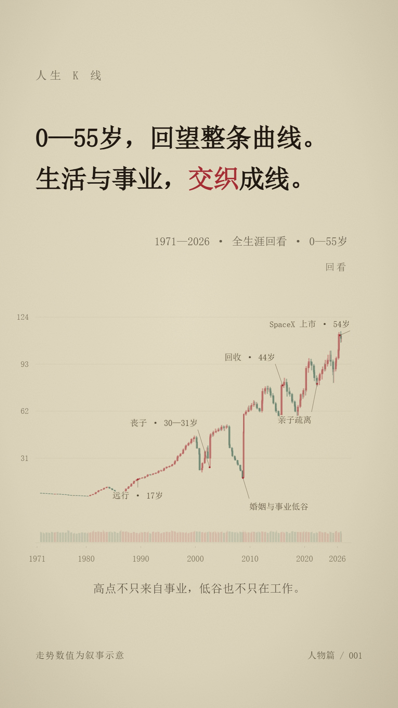

# 人生 K 线 · life-kline-video

一个把人物经历组织成纸感 K 线叙事的 Codex Skill：先梳理生活与事业，设计完整走势，再放大讲述，最后回看全程。

这是一次受参考作品启发的学习复刻，仍在改进。仓库提供 **Skill 指令、确定性 OHLC 数据编译器、虚构示例和实际制作经验**。生成 MP4 还需要 Codex 调用 HyperFrames 等视频框架，完成画面、文字、音乐与渲染。



## 灵感与署名

起点是此前在 X 看到的“人生如果是 K 线”视频。我们没有找到可直接使用的配套 Skill，于是请 Codex 按观察到的叙事思路尝试实现，再用马斯克的经历练习、审核和修改。

- 保留的参考帖：[QingQ77 分享的作品](https://x.com/QingQ77/status/2112417240431890526)。
- 参考画面的系列名为“世界切片”；目前尚未确认原始制作者，不能仅凭发帖账号认定原创归属。欢迎提供线索，以便补充署名。
- 感谢参考作品带来的启发。本仓库分享的是这次自行实现的指令、代码和经验，没有包含原视频、原片截图、音轨或署名素材。

具体观察见 [参考片笔记](references/reference-film.md)。

## 这个 Skill 做什么

- 同时梳理生活和工作的重要转折，保存事实出处。
- 每条事件主句以“XX岁，……”开头；日期不足时保留年龄范围。
- 先定全生涯总走势，再用同一份数据放大局部；横轴遵循历史年份。
- 生成可重复、可随机定位的 OHLC、事件标记和停牌／回看数据。
- 约束蜡烛密度、影线、标注避让和取景，避免全景拥挤、历史低谷被裁切。

数值是人为设定的**叙事指数**，不是真实股价、财富记录或人生价值评分。

## 安装与使用

把本仓库克隆为 Codex 的一个 Skill 文件夹。需要 Git；运行数据脚本需要 Python 3.10+，仅使用标准库。

macOS / Linux：

```bash
git clone https://github.com/superstonne/life-kline-video.git ~/.codex/skills/life-kline-video
```

Windows PowerShell：

```powershell
git clone https://github.com/superstonne/life-kline-video.git "$env:USERPROFILE\.codex\skills\life-kline-video"
```

若已自定义 Codex 的技能目录，请放入对应的 `skills/life-kline-video/`。重新打开 Codex 会话后，可以这样提问：

```text
使用 $life-kline-video，把苏轼的一生做成竖屏人生 K 线视频。
同时梳理生活与仕途，每条事件以年龄开头，已故人物讲到去世。
先给出有出处的事件表和总走势，再制作成片；结尾保留全景。
```

已有工程沿用其技术栈。新视频的默认流程会调用环境中的 HyperFrames Skill；没有可用的视频框架时，先安装相应工具，或明确只生成分镜和数据。调用外部媒体服务时沿用用户的授权与预算。

## 单独运行数据编译器

在仓库目录下运行：

```bash
python scripts/build_chart.py assets/example-story.json --output out/chart.json
python scripts/validate_chart.py
```

`example-story.json` 是一个虚构修复师的 2018—2024 年阶段故事，用于理解结构，不冒充完整人生。编译器输出数据 JSON；这一步不会生成 MP4。字段与渲染要求见 [数据与运动契约](references/data-motion.md)。

## 马斯克练习案例

[示例数据](examples/musk-2026/story.json)与[资料出处](examples/musk-2026/SOURCES.md)记录了本次 4 分 04.4 秒、55 段的练习，其中 17 段涉及生活与成长。示例资料截止于 2026-10-20；更换人物或截止日期时，需要重新研究事实。

我们在审核中逐步修正了年龄遗漏、生活线不足、蜡烛疏密、标注碰撞和纵轴裁切。经验见 [制作与验证笔记](references/musk-validation.md)。预览图为本项目绘制；字体文件、配乐和成片媒体未随仓库分发。马斯克数据可以直接交给同一个编译器：

```bash
python scripts/build_chart.py examples/musk-2026/story.json --output out/musk-chart.json
```

## 许可

本仓库自行编写的代码与文档采用 [MIT License](LICENSE)。链接指向的参考作品与外部资料归各自权利人所有，不在此许可范围内。
